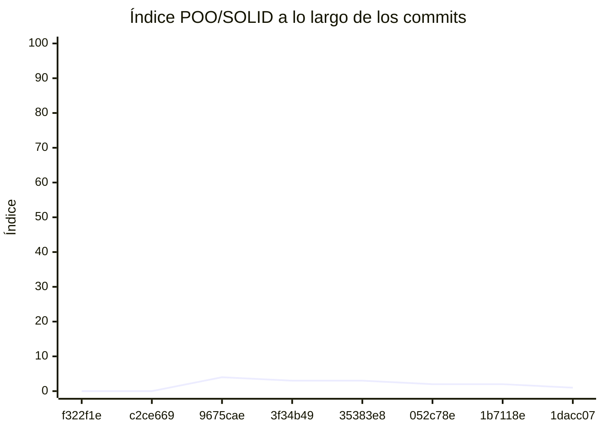

<!-- evaluacion:inicio -->
# Evaluación — centuriol/Proyecto_final_programacion2

> Documento **generado automáticamente** por la cátedra de Programación II (RepoSense + análisis de calidad POO/SOLID). **No editar a mano**: se regenera en cada evaluación.
> Rama evaluada: `main`. Análisis **heurístico** (regex + métricas): es una criba para orientar la revisión, **no una nota**.
> Generado: 2026-10-30.

## 1. Veredicto

| Aspecto | Resultado |
|---|---|
| Índice de calidad POO/SOLID | **1/100** |
| Código (LOC) | 12,819 |
| Archivos de código | 161 |
| Clases (bien usadas) | 175 (56 OK) |
| Código dentro de clases (%POO) | 87% |
| Funciones fuera de clases | 21 |
| Duplicación lógica | 1.1% |
| Señales S/O/L/I/D | 34/28/1/0/45 |
| Tope duro aplicado | `SUELTAS>=10` → índice ≤ 20 |

> Este informe **describe** lo que el análisis midió con los criterios ya establecidos de la materia. No es una nota.

### Semáforo de aprobación

Criterios de `CRITERIOS-CALIDAD.md`. **Aprobar** se juega con el perfil `estandar`; **destacar**, con el `exigente` (meta de excelencia).

| Semáforo | Resultado |
|---|---|
| Aprobar (`estandar`) | **no cumple** — 2/4 |
| Destacar (`exigente`) | **no cumple** — 1/5 |

**Criterios para aprobar**

| Criterio | Requisito | Tu resultado | Cumple |
|---|---|---|---|
| Código dentro de clases (%POO) | ≥ 85% | 87% | sí |
| Duplicación lógica | ≤ 10% | 1.1% | sí |
| Funciones fuera de clases | ≤ 1 | 21 | no |
| Señales POO/SOLID críticas | ninguna | Clase demasiado grande (SRP), Baja cohesión (LCOM), Complejidad alta, Acoplamiento alto (CBO), Switch sobre tipos (OCP), Override vacío / 'no implementado' (LSP) | no |

**Criterios para destacar**

| Criterio | Requisito | Tu resultado | Cumple |
|---|---|---|---|
| Código dentro de clases (%POO) | ≥ 95% | 87% | no |
| Duplicación lógica | ≤ 5% | 1.1% | sí |
| Funciones fuera de clases | ≤ 1 | 21 | no |
| Señales POO/SOLID críticas | ninguna | Clase demasiado grande (SRP), Baja cohesión (LCOM), Complejidad alta, Acoplamiento alto (CBO), Switch sobre tipos (OCP), Override vacío / 'no implementado' (LSP) | no |
| Índice de calidad POO/SOLID | ≥ 60 | 1/100 | no |

## 2. Autoría (RepoSense)

| Autor | Commits | Código (LOC) | Tests (LOC) | Docs (LOC) | Días activos | % del código |
|---|---:|---:|---:|---:|---:|---:|
| minibautista14-tech | 13 | 7,609 | 3,176 | 153 | 10 | 64% |
| mateovarelac | 3 | 4,341 | 427 | 0 | 4 | 36% |

> _El LOC de autoría lo calcula RepoSense sobre el historial y puede diferir del LOC de código del análisis de calidad (que mira solo el estado de `main`)._

> **Reparto del trabajo:** minibautista14-tech concentra el 64% de las líneas de código. Un reparto muy desigual suele indicar que la integración no fue realmente en equipo; vale la pena reconstruir cómo se coordinó.

## 3. Aspectos evaluados

Cada aspecto indica **qué mide**, **por qué importa** y **tu resultado**. Cuando el análisis reportó una señal, se agregan preguntas para **investigar la causa** (no hay recetas: entender el porqué es parte de la evaluación).

### 1. Índice de calidad POO/SOLID (indice)

- **Qué mide:** Un resumen numérico (0-100) que combina la riqueza de clases bien usadas con la penalización por señales POO/SOLID y duplicación, y luego aplica topes duros.
- **Por qué importa:** Ordena y prioriza la revisión: un índice bajo indica varias señales que conviene mirar juntas.
- **Tu resultado:** índice **1/100**

### 2. Duplicación lógica (DRY) (duplicacion) — con señales

- **Qué mide:** Porcentaje de bloques de LÓGICA repetidos. Quedan fuera imports/includes, anotaciones, declaraciones de campos y comentarios/Javadoc/docstrings: esos bloques son boilerplate, no lógica.
- **Por qué importa:** Cada copia de lógica se mantiene por separado: un arreglo hay que repetirlo y los defectos se multiplican.
- **Tu resultado:** **1.1%** de duplicación lógica
- **Para investigar la causa:**
    - ¿El trabajo se repartió por pantallas o archivos y se integró copiando y pegando bloques?
    - ¿Qué zonas del sistema cambiaron juntas más de una vez (señal de lógica compartida)?
    - ¿Hubo un lugar común acordado para la lógica repetida antes de empezar, o cada integrante resolvió lo suyo?

### 3. Adopción de POO (% de código en clases) (poo) — sin señales

- **Qué mide:** Qué porción del código vive dentro de clases (no de funciones sueltas).
- **Por qué importa:** El diseño orientado a objetos es el eje de la materia: el comportamiento debería vivir como método de una clase.
- **Tu resultado:** **87.1%** del código dentro de clases

### 4. Funciones fuera de clases (sueltas) — con señales

- **Qué mide:** Funciones de nivel de módulo que no pertenecen a ninguna clase (en esta materia el comportamiento debe ser método de una clase).
- **Por qué importa:** Son la forma más directa de código procedural en un proyecto que debería ser orientado a objetos.
- **Tu resultado:** **21** función(es) fuera de clases
- **Para investigar la causa:**
    - ¿Esa función se dejó suelta por urgencia o por desconocer dónde ubicarla?
    - ¿Qué clase debería ser responsable de ese comportamiento?
    - ¿Había una convención sobre dónde poner cada cosa?

### 5. Clase demasiado grande (SRP) (god) — con señales

- **Qué mide:** Clases con demasiadas líneas o métodos de LÓGICA. No cuentan los getters/setters triviales ni la cantidad de campos por sí sola.
- **Por qué importa:** Una clase que hace de todo cambia por muchos motivos y cuesta entenderla y probarla.
- **Tu resultado:** **18** clase(s) demasiado grande(s)
- **Para investigar la causa:**
    - ¿La clase creció por acumulación de responsabilidades?
    - ¿Qué partes de la clase se usan siempre juntas y cuáles no?
    - ¿Se podría describir su responsabilidad en una sola frase?

### 6. Baja cohesión (LCOM) (cohesion) — con señales

- **Qué mide:** Métodos y campos de una clase que casi no se relacionan entre sí.
- **Por qué importa:** Una unidad que cambia por motivos distintos y comparte poca información suele esconder más de una responsabilidad.
- **Tu resultado:** **15** clase(s) con baja cohesión
- **Para investigar la causa:**
    - ¿Qué métodos de la clase no comparten estado con el resto?
    - ¿Cambian por motivos distintos según la tarea?
    - ¿Se pensó su responsabilidad antes de escribirla, o se fue agregando?

### 7. Complejidad alta (complejidad) — con señales

- **Qué mide:** Complejidad ciclomática: cantidad de caminos posibles dentro de un método o función (condicionales, bucles, casos).
- **Por qué importa:** Muchos caminos = difícil de seguir y de probar; suelen esconderse casos sin cubrir.
- **Tu resultado:** **10** método(s)/función(es) con complejidad alta
- **Para investigar la causa:**
    - ¿Se agregaron condiciones a medida que aparecían casos nuevos?
    - ¿Se probaron todos los caminos o solo el caso principal?
    - ¿Hay reglas de negocio mezcladas con detalles técnicos?

### 8. Métodos/funciones largos o con muchos parámetros (tamano) — con señales

- **Qué mide:** Tamaño de los métodos/funciones y cantidad de parámetros.
- **Por qué importa:** Una función que hace varias cosas cuesta leerla, nombrarla y reutilizarla.
- **Tu resultado:** **84** método(s)/función(es) largos o con muchos parámetros
- **Para investigar la causa:**
    - ¿La función creció por acumulación de pasos?
    - ¿Agrupa operaciones que podrían describirse por separado?
    - ¿Los parámetros representan una misma idea (un objeto) o cosas sueltas?

### 9. Acoplamiento alto (CBO) (acoplamiento) — con señales

- **Qué mide:** Cuánto depende una clase de otros tipos del proyecto.
- **Por qué importa:** Piezas muy enlazadas hacen que un cambio se propague y que sea difícil reemplazar partes.
- **Tu resultado:** **80** clase(s) muy acoplada(s)
- **Para investigar la causa:**
    - ¿La clase conoce detalles internos de muchas otras?
    - ¿Se puede cambiar una parte sin tocar las demás?
    - ¿Los colaboradores llegan como parámetros o se crean por dentro?

### 10. Herencia profunda (DIT) (herencia) — con señales

- **Qué mide:** Profundidad de la cadena de herencia de una clase.
- **Por qué importa:** Jerarquías muy profundas vuelven difícil saber de dónde viene cada comportamiento.
- **Tu resultado:** **1** clase(s) con herencia profunda
- **Para investigar la causa:**
    - ¿La jerarquía creció para reutilizar código o para modelar una relación real 'es-un'?
    - ¿Qué comportamiento cambia entre niveles de la jerarquía?
    - ¿Se evaluó la composición como alternativa?

### 11. Switch sobre tipos (OCP) (ocp) — con señales

- **Qué mide:** Chequeos repetidos de tipo (`instanceof`/`is`/`typeof`) que equivalen a un switch sobre el tipo.
- **Por qué importa:** Cada tipo nuevo obliga a tocar varios lugares, en vez de extender con una implementación nueva.
- **Tu resultado:** **28** clase(s) con switch sobre tipos
- **Para investigar la causa:**
    - ¿Qué operación se resuelve preguntando el tipo?
    - ¿Qué se toca cada vez que aparece un tipo o caso nuevo?
    - ¿El comportamiento podría vivir en la propia jerarquía de tipos?

### 12. Interfaz con demasiados métodos (ISP) (isp) — sin señales

- **Qué mide:** Interfaces o clases abstractas con muchos métodos declarados.
- **Por qué importa:** Obliga a implementar operaciones que no se usan y acopla a los clientes a métodos que no necesitan.
- **Tu resultado:** **0** interfaz(es) con demasiados métodos

### 13. Override vacío o 'no implementado' (LSP) (lsp) — con señales

- **Qué mide:** Métodos sobrescritos que quedan vacíos o lanzan 'no implementado'.
- **Por qué importa:** Suele indicar que la jerarquía no representa bien el problema y rompe la sustitución entre clases.
- **Tu resultado:** **1** override(s) vacío(s) o 'no implementado'
- **Para investigar la causa:**
    - ¿Por qué ese método no tiene comportamiento en esa clase?
    - ¿La clase hereda algo que en realidad no le corresponde?
    - ¿Qué contrato se esperaba cumplir al heredar?

### 14. Dependencia de concretos y falta de abstracciones (DIP) (dip) — con señales

- **Qué mide:** Instanciación directa de clases concretas y ausencia de interfaces o clases abstractas pese al acoplamiento.
- **Por qué importa:** Depender de implementaciones concretas dificulta cambiar o probar una parte sin arrastrar las demás.
- **Tu resultado:** **45** dependencia(s) de concretos sin abstracciones
- **Para investigar la causa:**
    - ¿La clase crea por dentro a sus colaboradores en vez de recibirlos?
    - ¿Hay puntos de variación que convendría expresar como abstracción?
    - ¿Cómo se probaría esa clase cambiando una implementación?

### 15. Clase sin métodos (solo datos) (data) — con señales

- **Qué mide:** Clases que solo acumulan campos y no tienen comportamiento.
- **Por qué importa:** Separar datos de comportamiento reparte por el proyecto la lógica que debería estar cerca de esos datos.
- **Tu resultado:** **2** clase(s) sin métodos (solo datos)
- **Para investigar la causa:**
    - ¿Dónde vive el comportamiento que opera sobre esos datos?
    - ¿La clase representa un concepto del dominio o un contenedor técnico?
    - ¿Se evita la lógica de negocio dentro de la clase por comodidad?

### 16. Campos públicos (encapsulación) (encapsulacion) — con señales

- **Qué mide:** Clases que exponen campos sin control de acceso.
- **Por qué importa:** Expone el estado interno y hace que cualquier cambio dependa de quién lo modifica desde afuera.
- **Tu resultado:** **8** clase(s) con campos públicos
- **Para investigar la causa:**
    - ¿Se accede al campo desde otras clases para evitar un método?
    - ¿Qué reglas deberían respetarse al modificar ese estado?
    - ¿Los campos públicos se usan más como configuración que como estado?

### 17. Clase solo con métodos estáticos (utilitaria) (static) — con señales

- **Qué mide:** Clases donde todos los métodos son estáticos.
- **Por qué importa:** Es comportamiento procedural disfrazado de clase: no se instancia ni participa del modelo de objetos.
- **Tu resultado:** **3** clase(s) solo con métodos estáticos
- **Para investigar la causa:**
    - ¿Por qué no hace falta una instancia en esa clase?
    - ¿Los métodos operan sobre estado que podría vivir en un objeto?
    - ¿Se usó clase solo para agrupar funciones sueltas?

## 4. Anexo: dónde mirar

Archivos donde el análisis encontró cada señal (sin número de línea, a propósito):

**Clase demasiado grande (SRP) (god)** — 18 archivo(s):
- `app/src/main/java/org/example/App.java`
- `app/src/main/java/org/example/game/civilizacion/CivilizacionComponent.java`
- `app/src/main/java/org/example/game/controlador/ControladorMouse.java`
- `app/src/main/java/org/example/game/cuerpo/CuerpoCeleste.java`
- `app/src/main/java/org/example/game/cuerpo/CuerpoCelesteFactory.java`
- `app/src/main/java/org/example/game/cuerpo/Planeta.java`
- `app/src/main/java/org/example/game/jugador/InventarioJugador.java`
- `app/src/main/java/org/example/game/motor/AsistenteOrbital.java`
- `app/src/main/java/org/example/game/motor/MotorFisicaPermisiva.java`
- `app/src/main/java/org/example/game/motor/ResolvedorColisiones.java`
- `app/src/main/java/org/example/game/progresion/SistemaProgresion.java`
- `app/src/main/java/org/example/game/render/GestorImagenes.java`
- `app/src/main/java/org/example/game/render/RenderizadorPixelArt.java`
- `app/src/main/java/org/example/game/simulacion/SimulacionSolar.java`
- `app/src/main/java/org/example/game/ui/BarraInventarioHotbar.java`
- `app/src/main/java/org/example/game/ui/PantallaArbolProgresion.java`
- `app/src/main/java/org/example/game/ui/SeccionInfoCuerpo.java`
- `app/src/main/java/org/example/game/ui/VentanaDescripcionCuerpo.java`

**Baja cohesión (LCOM) (cohesion)** — 15 archivo(s):
- `app/src/main/java/org/example/App.java`
- `app/src/main/java/org/example/game/controlador/ControladorMouse.java`
- `app/src/main/java/org/example/game/cuerpo/CuerpoCeleste.java`
- `app/src/main/java/org/example/game/cuerpo/Meteorito.java`
- `app/src/main/java/org/example/game/cuerpo/Planeta.java`
- `app/src/main/java/org/example/game/efectos/GestorEfectos.java`
- `app/src/main/java/org/example/game/motor/MotorFisicaBase.java`
- `app/src/main/java/org/example/game/motor/MotorFisicaPermisiva.java`
- `app/src/main/java/org/example/game/render/GestorImagenes.java`
- `app/src/main/java/org/example/game/render/RenderizadorFondo.java`
- `app/src/main/java/org/example/game/render/RenderizadorPixelArt.java`
- `app/src/main/java/org/example/game/simulacion/BusEventos.java`
- `app/src/main/java/org/example/game/simulacion/SimulacionSolar.java`
- `app/src/main/java/org/example/game/ui/BarraInventarioHotbar.java`
- `app/src/main/java/org/example/game/ui/ControlTiempoWidget.java`

**Complejidad alta (complejidad)** — 9 archivo(s):
- `app/src/main/java/org/example/game/civilizacion/EvaluadorHabitabilidad.java`
- `app/src/main/java/org/example/game/motor/GestorAgujeroNegro.java`
- `app/src/main/java/org/example/game/motor/TransformadorCuerpos.java`
- `app/src/main/java/org/example/game/motor/colision/ReglaColisionMeteorito.java`
- `app/src/main/java/org/example/game/render/GestorImagenes.java`
- `app/src/main/java/org/example/game/simulacion/GestorEconomia.java`
- `app/src/main/java/org/example/game/simulacion/SimulacionSolar.java`
- `app/src/main/java/org/example/game/ui/VentanaColocacion.java`
- `app/src/test/java/org/example/TransformacionCuerposTest.java`

**Métodos/funciones largos o con muchos parámetros (tamano)** — 62 archivo(s):
- `app/src/main/java/org/example/game/civilizacion/CivilizacionComponent.java`
- `app/src/main/java/org/example/game/civilizacion/EvaluadorHabitabilidad.java`
- `app/src/main/java/org/example/game/colonizacion/GestorColonizacion.java`
- `app/src/main/java/org/example/game/controlador/CombinacionTeclas.java`
- `app/src/main/java/org/example/game/controlador/SeleccionadorCuerpoMouse.java`
- `app/src/main/java/org/example/game/cuerpo/AgujeroNegro.java`
- `app/src/main/java/org/example/game/cuerpo/CuerpoCeleste.java`
- `app/src/main/java/org/example/game/cuerpo/CuerpoCelesteFactory.java`
- `app/src/main/java/org/example/game/cuerpo/Planeta.java`
- `app/src/main/java/org/example/game/cuerpo/ServicioEscudo.java`
- `app/src/main/java/org/example/game/motor/AsistenteOrbital.java`
- `app/src/main/java/org/example/game/motor/CalculadorGravedad.java`
- `app/src/main/java/org/example/game/motor/CapturaOrbitalMenorPlaneta.java`
- `app/src/main/java/org/example/game/motor/CapturaOrbitalPlanetaAtractor.java`
- `app/src/main/java/org/example/game/motor/GestorAgujeroNegro.java`
- `app/src/main/java/org/example/game/motor/MotorFisicaPermisiva.java`
- `app/src/main/java/org/example/game/motor/TransformadorCuerpos.java`
- `app/src/main/java/org/example/game/motor/Vector2D.java`
- `app/src/main/java/org/example/game/motor/colision/ReglaColisionMeteorito.java`
- `app/src/main/java/org/example/game/render/GestorImagenes.java`
- `app/src/main/java/org/example/game/render/RenderizadorFondo.java`
- `app/src/main/java/org/example/game/render/RenderizadorPixelArt.java`
- `app/src/main/java/org/example/game/render/UtilidadRender.java`
- `app/src/main/java/org/example/game/render/capa/CapaGhostPreview.java`
- `app/src/main/java/org/example/game/render/cuerpo/RenderizadorAgujeroNegro.java`
- `app/src/main/java/org/example/game/render/cuerpo/RenderizadorEstrella.java`
- `app/src/main/java/org/example/game/render/cuerpo/RenderizadorLuna.java`
- `app/src/main/java/org/example/game/render/cuerpo/RenderizadorMeteorito.java`
- `app/src/main/java/org/example/game/render/cuerpo/RenderizadorPlaneta.java`
- `app/src/main/java/org/example/game/render/cuerpo/RenderizadorSatelite.java`
- `app/src/main/java/org/example/game/simulacion/SimulacionSolar.java`
- `app/src/main/java/org/example/game/ui/BarraInventarioHotbar.java`
- `app/src/main/java/org/example/game/ui/ControlTiempoWidget.java`
- `app/src/main/java/org/example/game/ui/PantallaArbolProgresion.java`
- `app/src/main/java/org/example/game/ui/PantallaGameOver.java`
- `app/src/main/java/org/example/game/ui/SeccionInfoCuerpo.java`
- `app/src/main/java/org/example/game/ui/SlotHotbar.java`
- `app/src/main/java/org/example/game/ui/VentanaColocacion.java`
- `app/src/main/java/org/example/game/ui/VentanaInspeccion.java`
- `app/src/main/java/org/example/game/ui/VentanaProgresion.java`
- `app/src/main/java/org/example/game/ui/WidgetFactorMasa.java`
- `app/src/test/java/org/example/AgujeroNegroFisicaTest.java`
- `app/src/test/java/org/example/CivilizacionSinergiaTest.java`
- `app/src/test/java/org/example/ColisionesFisicaTest.java`
- `app/src/test/java/org/example/ColonizacionYEscudosTest.java`
- `app/src/test/java/org/example/ControladorMouseYHelpersTest.java`
- `app/src/test/java/org/example/ControladorTecladoYComandosTest.java`
- `app/src/test/java/org/example/EasterEggFusionYRadiosTest.java`
- `app/src/test/java/org/example/EconomiaRecursosTest.java`
- `app/src/test/java/org/example/EventosCosmicosYSatelitesTest.java`
- `app/src/test/java/org/example/Fase2BugsTest.java`
- `app/src/test/java/org/example/GestorSpritesYPixilTest.java`
- `app/src/test/java/org/example/HotbarYVentanaTest.java`
- `app/src/test/java/org/example/MecanicasColisionYVidaTest.java`
- `app/src/test/java/org/example/OrbitasYDinamicaTest.java`
- `app/src/test/java/org/example/ProgresionYArbolTest.java`
- `app/src/test/java/org/example/ReembolsoYColocacionTest.java`
- `app/src/test/java/org/example/RenderizadorAnimacionYFondoTest.java`
- `app/src/test/java/org/example/RendimientoRegresionTest.java`
- `app/src/test/java/org/example/SolidAbstraccionesRefactorTest.java`
- `app/src/test/java/org/example/TransformacionCuerposTest.java`
- `app/src/test/java/org/example/UIWidgetsYFormatoTest.java`

**Acoplamiento alto (CBO) (acoplamiento)** — 79 archivo(s):
- `app/src/main/java/org/example/App.java`
- `app/src/main/java/org/example/game/civilizacion/CivilizacionComponent.java`
- `app/src/main/java/org/example/game/civilizacion/EvaluadorHabitabilidad.java`
- `app/src/main/java/org/example/game/colonizacion/GestorColonizacion.java`
- `app/src/main/java/org/example/game/controlador/ConfiguradorAtajosTeclado.java`
- `app/src/main/java/org/example/game/controlador/ControladorMouse.java`
- `app/src/main/java/org/example/game/controlador/ControladorTeclado.java`
- `app/src/main/java/org/example/game/cuerpo/CatalogoDescriptoresCuerpo.java`
- `app/src/main/java/org/example/game/cuerpo/CuerpoCelesteFactory.java`
- `app/src/main/java/org/example/game/cuerpo/Meteorito.java`
- `app/src/main/java/org/example/game/cuerpo/Planeta.java`
- `app/src/main/java/org/example/game/cuerpo/Satelite.java`
- `app/src/main/java/org/example/game/cuerpo/ServicioEscudo.java`
- `app/src/main/java/org/example/game/cuerpo/TipoCuerpo.java`
- `app/src/main/java/org/example/game/jugador/InventarioJugador.java`
- `app/src/main/java/org/example/game/jugador/ServicioReembolso.java`
- `app/src/main/java/org/example/game/motor/AsistenteOrbital.java`
- `app/src/main/java/org/example/game/motor/CalculadorGravedad.java`
- `app/src/main/java/org/example/game/motor/MotorFisicaBase.java`
- `app/src/main/java/org/example/game/motor/MotorFisicaPermisiva.java`
- `app/src/main/java/org/example/game/motor/ResolvedorColisiones.java`
- `app/src/main/java/org/example/game/motor/TransformadorCuerpos.java`
- `app/src/main/java/org/example/game/motor/colision/ReglaColisionAgujeroNegro.java`
- `app/src/main/java/org/example/game/motor/colision/ReglaColisionAsimetrica.java`
- `app/src/main/java/org/example/game/motor/colision/ReglaColisionEscudo.java`
- `app/src/main/java/org/example/game/motor/colision/ReglaColisionEstrella.java`
- `app/src/main/java/org/example/game/motor/colision/ReglaColisionFusionAguaLava.java`
- `app/src/main/java/org/example/game/motor/colision/ReglaColisionMeteorito.java`
- `app/src/main/java/org/example/game/motor/colision/UtilidadColision.java`
- `app/src/main/java/org/example/game/progresion/ElementoDesbloqueable.java`
- `app/src/main/java/org/example/game/progresion/SistemaProgresion.java`
- `app/src/main/java/org/example/game/render/GestorEstelas.java`
- `app/src/main/java/org/example/game/render/GestorImagenes.java`
- `app/src/main/java/org/example/game/render/RenderizadorPixelArt.java`
- `app/src/main/java/org/example/game/render/capa/CapaAreaAtraccion.java`
- `app/src/main/java/org/example/game/render/capa/CapaGhostPreview.java`
- `app/src/main/java/org/example/game/render/cuerpo/RenderizadorAgujeroNegro.java`
- `app/src/main/java/org/example/game/render/cuerpo/RenderizadorEstrella.java`
- `app/src/main/java/org/example/game/render/cuerpo/RenderizadorLuna.java`
- `app/src/main/java/org/example/game/render/cuerpo/RenderizadorPlaneta.java`
- `app/src/main/java/org/example/game/simulacion/ControladorColocacion.java`
- `app/src/main/java/org/example/game/simulacion/GeneradorEventosCosmicos.java`
- `app/src/main/java/org/example/game/simulacion/SimulacionSolar.java`
- `app/src/main/java/org/example/game/ui/BarraInventarioHotbar.java`
- `app/src/main/java/org/example/game/ui/ControlTiempoWidget.java`
- `app/src/main/java/org/example/game/ui/HUDRecursosTop.java`
- `app/src/main/java/org/example/game/ui/PanelNotificaciones.java`
- `app/src/main/java/org/example/game/ui/PantallaArbolProgresion.java`
- `app/src/main/java/org/example/game/ui/PantallaGameOver.java`
- `app/src/main/java/org/example/game/ui/SeccionInfoCuerpo.java`
- `app/src/main/java/org/example/game/ui/SlotHotbar.java`
- `app/src/main/java/org/example/game/ui/TemaUI.java`
- `app/src/main/java/org/example/game/ui/VentanaColocacion.java`
- `app/src/main/java/org/example/game/ui/VentanaDescripcionCuerpo.java`
- `app/src/main/java/org/example/game/ui/VentanaInspeccion.java`
- `app/src/main/java/org/example/game/ui/VentanaProgresion.java`
- `app/src/main/java/org/example/game/ui/WidgetFactorMasa.java`
- `app/src/test/java/org/example/AgujeroNegroFisicaTest.java`
- `app/src/test/java/org/example/CivilizacionSinergiaTest.java`
- `app/src/test/java/org/example/ColisionesFisicaTest.java`
- `app/src/test/java/org/example/ColonizacionYEscudosTest.java`
- `app/src/test/java/org/example/ControladorMouseYHelpersTest.java`
- `app/src/test/java/org/example/ControladorTecladoYComandosTest.java`
- `app/src/test/java/org/example/EasterEggFusionYRadiosTest.java`
- `app/src/test/java/org/example/EconomiaRecursosTest.java`
- `app/src/test/java/org/example/EventosCosmicosYSatelitesTest.java`
- `app/src/test/java/org/example/Fase2BugsTest.java`
- `app/src/test/java/org/example/GestorSpritesYPixilTest.java`
- `app/src/test/java/org/example/HotbarYVentanaTest.java`
- `app/src/test/java/org/example/MecanicasColisionYVidaTest.java`
- `app/src/test/java/org/example/OrbitasYDinamicaTest.java`
- `app/src/test/java/org/example/ProgresionYArbolTest.java`
- `app/src/test/java/org/example/ReembolsoYColocacionTest.java`
- `app/src/test/java/org/example/ReglasColisionTest.java`
- `app/src/test/java/org/example/RenderizadorAnimacionYFondoTest.java`
- `app/src/test/java/org/example/RendimientoRegresionTest.java`
- `app/src/test/java/org/example/SolidAbstraccionesRefactorTest.java`
- `app/src/test/java/org/example/TransformacionCuerposTest.java`
- `app/src/test/java/org/example/UIWidgetsYFormatoTest.java`

**Herencia profunda (DIT) (herencia)** — 1 archivo(s):
- `app/src/test/java/org/example/SolidAbstraccionesRefactorTest.java`

**Switch sobre tipos (OCP) (ocp)** — 28 archivo(s):
- `app/src/main/java/org/example/game/colonizacion/GestorColonizacion.java`
- `app/src/main/java/org/example/game/colonizacion/NaveColonizadora.java`
- `app/src/main/java/org/example/game/cuerpo/AgujeroNegro.java`
- `app/src/main/java/org/example/game/cuerpo/CuerpoCeleste.java`
- `app/src/main/java/org/example/game/cuerpo/CuerpoCelesteFactory.java`
- `app/src/main/java/org/example/game/motor/GestorAgujeroNegro.java`
- `app/src/main/java/org/example/game/motor/MotorFisicaBase.java`
- `app/src/main/java/org/example/game/motor/MotorFisicaPermisiva.java`
- `app/src/main/java/org/example/game/motor/TransformadorCuerpos.java`
- `app/src/main/java/org/example/game/motor/colision/ReglaColisionAsimetrica.java`
- `app/src/main/java/org/example/game/motor/colision/ReglaColisionEscudo.java`
- `app/src/main/java/org/example/game/motor/colision/ReglaColisionFusionAguaLava.java`
- `app/src/main/java/org/example/game/motor/colision/ReglaColisionMeteorito.java`
- `app/src/main/java/org/example/game/motor/colision/UtilidadColision.java`
- `app/src/main/java/org/example/game/render/RenderizadorPixelArt.java`
- `app/src/main/java/org/example/game/render/cuerpo/RenderizadorPlaneta.java`
- `app/src/main/java/org/example/game/simulacion/GestorEconomia.java`
- `app/src/main/java/org/example/game/simulacion/SimulacionSolar.java`
- `app/src/main/java/org/example/game/ui/VentanaInspeccion.java`
- `app/src/test/java/org/example/ColisionesFisicaTest.java`
- `app/src/test/java/org/example/ControladorTecladoYComandosTest.java`
- `app/src/test/java/org/example/EasterEggFusionYRadiosTest.java`
- `app/src/test/java/org/example/EventosCosmicosYSatelitesTest.java`
- `app/src/test/java/org/example/GestorSpritesYPixilTest.java`
- `app/src/test/java/org/example/MecanicasColisionYVidaTest.java`
- `app/src/test/java/org/example/OrbitasYDinamicaTest.java`
- `app/src/test/java/org/example/SolidAbstraccionesRefactorTest.java`
- `app/src/test/java/org/example/UIWidgetsYFormatoTest.java`

**Override vacío o 'no implementado' (LSP) (lsp)** — 1 archivo(s):
- `app/src/main/java/org/example/game/ui/PantallaGameOver.java`

**Dependencia de concretos y falta de abstracciones (DIP) (dip)** — 45 archivo(s):
- `app/src/main/java/org/example/App.java`
- `app/src/main/java/org/example/game/colonizacion/GestorColonizacion.java`
- `app/src/main/java/org/example/game/controlador/ConfiguradorAtajosTeclado.java`
- `app/src/main/java/org/example/game/cuerpo/CatalogoDescriptoresCuerpo.java`
- `app/src/main/java/org/example/game/cuerpo/CuerpoCelesteFactory.java`
- `app/src/main/java/org/example/game/jugador/InventarioJugador.java`
- `app/src/main/java/org/example/game/motor/AsistenteOrbital.java`
- `app/src/main/java/org/example/game/motor/MotorFisicaPermisiva.java`
- `app/src/main/java/org/example/game/motor/ResolvedorColisiones.java`
- `app/src/main/java/org/example/game/motor/TransformadorCuerpos.java`
- `app/src/main/java/org/example/game/render/GestorImagenes.java`
- `app/src/main/java/org/example/game/render/RenderizadorPixelArt.java`
- `app/src/main/java/org/example/game/simulacion/SimulacionSolar.java`
- `app/src/main/java/org/example/game/ui/BarraInventarioHotbar.java`
- `app/src/main/java/org/example/game/ui/ControlTiempoWidget.java`
- `app/src/main/java/org/example/game/ui/HUDRecursosTop.java`
- `app/src/main/java/org/example/game/ui/PanelNotificaciones.java`
- `app/src/main/java/org/example/game/ui/PantallaArbolProgresion.java`
- `app/src/main/java/org/example/game/ui/PantallaGameOver.java`
- `app/src/main/java/org/example/game/ui/SeccionInfoCuerpo.java`
- `app/src/main/java/org/example/game/ui/SlotHotbar.java`
- `app/src/main/java/org/example/game/ui/TemaUI.java`
- `app/src/main/java/org/example/game/ui/VentanaColocacion.java`
- `app/src/main/java/org/example/game/ui/VentanaInspeccion.java`
- `app/src/main/java/org/example/game/ui/VentanaProgresion.java`
- `app/src/main/java/org/example/game/ui/WidgetFactorMasa.java`
- `app/src/test/java/org/example/AgujeroNegroFisicaTest.java`
- `app/src/test/java/org/example/CivilizacionSinergiaTest.java`
- `app/src/test/java/org/example/ControladorMouseYHelpersTest.java`
- `app/src/test/java/org/example/ControladorTecladoYComandosTest.java`
- `app/src/test/java/org/example/EasterEggFusionYRadiosTest.java`
- `app/src/test/java/org/example/EconomiaRecursosTest.java`
- `app/src/test/java/org/example/EventosCosmicosYSatelitesTest.java`
- `app/src/test/java/org/example/Fase2BugsTest.java`
- `app/src/test/java/org/example/GestorSpritesYPixilTest.java`
- `app/src/test/java/org/example/HotbarYVentanaTest.java`
- `app/src/test/java/org/example/MecanicasColisionYVidaTest.java`
- `app/src/test/java/org/example/OrbitasYDinamicaTest.java`
- `app/src/test/java/org/example/ReembolsoYColocacionTest.java`
- `app/src/test/java/org/example/ReglasColisionTest.java`
- `app/src/test/java/org/example/RenderizadorAnimacionYFondoTest.java`
- `app/src/test/java/org/example/RendimientoRegresionTest.java`
- `app/src/test/java/org/example/SolidAbstraccionesRefactorTest.java`
- `app/src/test/java/org/example/TransformacionCuerposTest.java`
- `app/src/test/java/org/example/UIWidgetsYFormatoTest.java`

**Clase sin métodos (solo datos) (data)** — 2 archivo(s):
- `app/src/test/java/org/example/ControladorMouseYHelpersTest.java`
- `app/src/test/java/org/example/ControladorTecladoYComandosTest.java`

**Campos públicos (encapsulación) (encapsulacion)** — 8 archivo(s):
- `app/src/main/java/org/example/game/cuerpo/TipoCuerpo.java`
- `app/src/main/java/org/example/game/jugador/TipoRecurso.java`
- `app/src/main/java/org/example/game/motor/ConstantesFisicas.java`
- `app/src/main/java/org/example/game/simulacion/ConfiguracionColisiones.java`
- `app/src/main/java/org/example/game/simulacion/ConfiguracionEconomia.java`
- `app/src/main/java/org/example/game/simulacion/ConfiguracionSimulacion.java`
- `app/src/main/java/org/example/game/simulacion/ConfiguracionTransformacion.java`
- `app/src/main/java/org/example/game/ui/TemaUI.java`

**Clase solo con métodos estáticos (utilitaria) (static)** — 3 archivo(s):
- `app/src/main/java/org/example/game/controlador/ConfiguradorAtajosTeclado.java`
- `app/src/main/java/org/example/game/simulacion/PresetsSistema.java`
- `app/src/main/java/org/example/game/ui/VentanaDescripcionCuerpo.java`

## 5. Evolución por commit

Métricas calculadas sobre el estado de `main` en **cada commit** (8 commits con trabajo), del primero al último. La calidad usa el perfil `exigente`; el aporte de código lo mide RepoSense. El índice puede **bajar** al crecer el proyecto: se acumulan señales.

| # | Fecha | Commit | Autor | LOC | Índice | %POO | Duplic. | Sueltas |
|---|---|---|---|---:|---:|---:|---:|---:|
| 1 | 2026-08-14 | `f322f1e` | minibautista14-tech | 0 | 0 | 0% | 0.0% | 0 |
| 2 | 2026-08-24 | `c2ce669` | dqmdz-etec | 0 | 0 | 0% | 0.0% | 0 |
| 3 | 2026-08-28 | `9675cae` | minibautista14-tech | 4,178 | 4 | 90% | 2.2% | 0 |
| 4 | 2026-09-07 | `3f34b49` | minibautista14-tech | 6,476 | 3 | 94% | 2.0% | 0 |
| 5 | 2026-09-25 | `35383e8` | mateovarelac | 7,073 | 3 | 92% | 1.9% | 0 |
| 6 | 2026-10-05 | `052c78e` | minibautista14-tech | 7,965 | 2 | 92% | 2.6% | 0 |
| 7 | 2026-10-19 | `1b7118e` | mateovarelac | 10,628 | 2 | 91% | 1.1% | 0 |
| 8 | 2026-10-30 | `1dacc07` | minibautista14-tech | 12,819 | 1 | 87% | 1.1% | 21 |

---
_Informe generado por la cátedra. Los criterios y umbrales de medición corresponden al perfil `exigente` de `calidad.py`; el semáforo de aprobación, a `CRITERIOS-CALIDAD.md` (ver `README.md`). Ante dudas, revisá el archivo señalado._
<!-- evaluacion:fin -->
